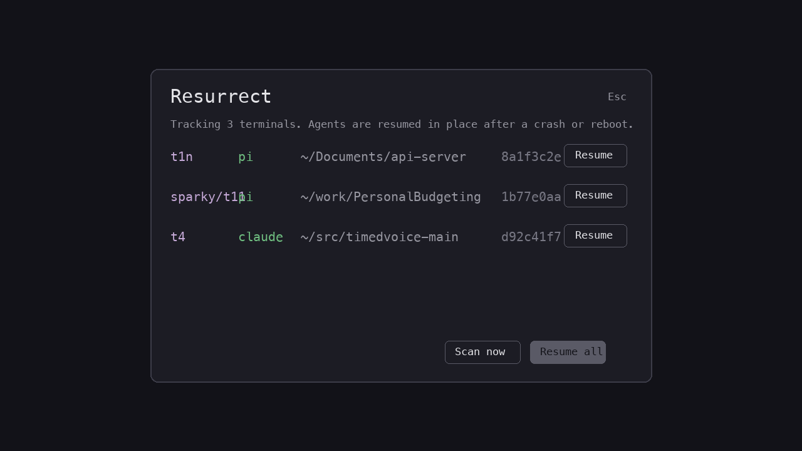

# Resurrect

A Herdr app mod that remembers which coding agent ran in each pane and
resumes it in place after a crash or reboot — `tmux-resurrect` /
`resume_agents_on_restore` for the Herdr app. When herdr-core recovers a
lost terminal as a bare shell, Resurrect types the agent's own resume
command (`claude --resume <id>`, `pi --session <id>`, `codex resume <id>`)
back into it, so the conversation continues where it was.

## What you see

A 1 px worker strip docked at the bottom of the layout (invisible). Open
the panel with `mod.open resurrect` from the command palette: a centered
dialog, dark card on the workspace background, with a **Resurrect** title
and an Esc hint top-right. Under it, one muted line: how many terminals are
tracked and the one-sentence promise ("Agents are resumed in place after a
crash or reboot."). Then one row per tracked terminal in monospace: the
terminal address in the accent color, the agent name in green, the folder
(shortened with `~`), the session id's first 8 characters in gray, and a
small outlined **Resume** button on the right. A scrollbar appears when the
list is long. Footer, right-aligned: an outlined **Scan now** button and a
solid **Resume all** button.

## How it behaves

- Every Herdr live-data change (and every 30 s), the worker reads the
  core's terminal records. A pane whose foreground is a known agent is
  remembered: agent name, argv, cwd, machine, and session id when the
  running argv carries one.
- herdr-core keeps a terminal alive across crashes and reboots by replacing
  its lost program with a shell in the same folder, and clears the record's
  `reported` flag when it does. When the worker next sees that pane sitting
  at an idle shell, it waits 2 s for the shell to settle, then types the
  agent's resume command in once. A success toast names the agent and pane.
- An agent exited normally inside its shell is never relaunched: no loss
  was observed and `reported` stays set.
- Known agents and their resume flags: claude (`--resume` / `--continue`),
  codex (`resume <id>` / `resume --last`), pi and omp (`--session <id>` /
  `--continue` / `--resume=<id>`), copilot, gemini, cursor (cursor-agent),
  devin, droid, kimi, mastracode, hermes, opencode, qodercli, qwen, kilo,
  grok. A `config.json` beside main.js (see `config.json.example`) adds or
  replaces agents, declares wrapper process names, and tunes the timings,
  so the mod itself never needs editing.
- **Resume** on a row and **Resume all** type the same command on demand —
  for agents lost while the app was closed, or plain programs (tracked,
  never auto-rerun).
- A failed resume shows a warning toast with the reason.

## Built from

- `mods/resurrect/` only — `main.js` (one exported `View`), `mod.json`
  (`place: bottom`, `size: 1`, so Herdr docks the invisible worker strip on
  first install; `overlay` describes the panel dialog, opened with
  `mod.open resurrect`).
- The worker copy renders nothing (`div().w(0).h(0)`) and runs `observe()`
  on every render and on a 30 s `cx.timer.every`; overlay copies (the
  panel) render the list. State persists in `localStorage`
  (`data/resurrect/store.json`), surviving app restarts.
- Herdr module functions: `terminals()` for live records, `readTextFile()`
  + `appHome()` for config.json, `hc()` to
  `hc send <address> <command>`, `exec()` to look up session ids in the
  agent CLIs' on-disk stores (claude `~/.claude/projects/<munged cwd>`,
  pi/omp `~/.pi/agent/sessions/<munged cwd>`, codex `~/.codex/sessions`),
  `notify()` for toasts, `props()` to tell worker from panel, `checking()`
  to keep `herdr-app check` side-effect free, `theme()` colors.
- The panel is `v_flex`/`h_flex` from gpui-base with `div` from gpui-kit.

## Watch out

- The worker must run in a **shown layout** to watch; this build docks
  itself (`place: bottom`, 1 px), so it survives layout switches except a
  layout that removes it.
- Mods under a **symlinked folder do not hot-reload** in a running Herdr —
  restart Herdr after editing (terminals keep running in herdr-core; the
  worker re-reads its store at start).
- The loss signal is core clearing `reported` on a kept recovery (or an
  observed `holder_lost` / `signaled` / `host_shutdown` / `server_stop` /
  `stopped_by_restart` reason). A kill (`hc kill`) or normal exit is
  final and never resumed.
- Session-store lookup runs on the terminal's machine via `exec({on})`; it
  needs `sh` on PATH there. Without a session id the agent's continue
  flag is used instead.
- The 500 ms record polling is Herdr's own; very short loss-and-recover
  cycles could still race the observation, but the `reported` flag makes
  the after-state detectable, not just the transition.
- Remembers terminals for a week after they disappear.

## Done when

- `herdr-app check ~/.config/herdr-app/mods/resurrect` passes.
- With an agent running (e.g. pi), `data/resurrect/store.json` gains an
  entry with the agent and cwd within a minute.
- `kill -9 <pane pid>`: core restarts a shell in the pane and, within
  ~10 s, the agent reappears in the same pane, with a success toast.
- Exiting the agent inside its shell (Ctrl+D / exit) does **not**
  relaunch it.
- `mod.open resurrect` lists tracked panes; Resume types the command.
