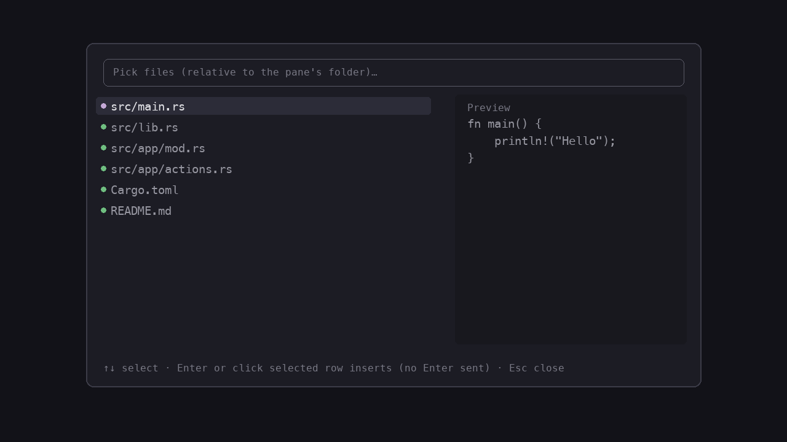

# File Picker

A Herdr app mod that lists files with fd and inserts the selected paths
into the focused terminal without pressing Enter — a port of
[herdr-file-picker](https://github.com/shivammehta25/herdr-file-picker)
(TUI plugin) to the Herdr app's mod system, for prompting AI coding
agents.

## What you see

A centered dialog (760×480) over the workspace: a dark popover card on
the canvas background. Top: an input field with the muted placeholder
"Pick files (relative to the pane's folder)…" (or the variant's wording).
Left: a monospace list of paths, one per 26 px row, each with a small
green dot; the selected row has a raised background and brighter text;
typing filters, ↑/↓ move the selection. Right: a 300 px preview pane
(surface background) titled "Preview" in small dim text, showing the
selected file's first 4 KB as text lines (or "Select a file" / "(binary
or too large)"). Footer, small dim text: "↑↓ select · Enter or click
selected row inserts (no Enter sent) · Esc close".

## How it behaves

- Typing filters the list live; ↑/↓ wrap; Enter inserts; clicking a row
  selects and previews it, clicking the already-selected row inserts;
  Esc closes.
- Insertion never sends Enter: the paths land on the pane's command line
  or in the agent's input, ready for the rest of the prompt.
- With an agent in the target pane, paths are `@`-prefixed ("@src/x.rs
  fix this"); otherwise they are shell-quoted ("src/my file.rs").
- Variants via mod commands: `pick` (pane folder), `pick-git-root`
  (errors with a toast when not in a repo), `pick-dirs`, `pick-zoxide`
  (two-stage: pick a directory from `zoxide query -l`, then a file in
  it), `pick-zoxide-dirs`.
- Missing fd/fdfind or zoxide shows a warning toast, not a crash.

## Built from

- `mods/file-picker/` only — `main.js` (one exported `View`) and
  `mod.json` (`place: bottom`, `size: 1`, an overlay dialog 760×480,
  `focusable: true`).
- Herdr module functions: `focused()` for the target pane's terminal and
  cwd, `terminals()`/`panes()` for agent detection, `exec()` for fd /
  zoxide / clipboard, `readTextFile()` for previews, `run()` for
  `terminal.paste`, `props()`/`openOverlay` via mod commands,
  `nextCommand()` for the command listener, `checking()` to keep
  `herdr-app check` side-effect free, `theme()` colors.
- Insertion route: clipboard (pbcopy/xclip/wl-copy/clip.exe) written via
  `sh -c "printf '%s' … | pbcopy"`, then `closeOverlay` and
  `run("terminal.paste")` — the app's paste goes to the pane that
  regains focus and never sends Enter.
- Path math (join/normalize/relativeTo) is pure JS, ported from the TUI
  plugin's `_normalize_path`/`_relative_to` (which existed to avoid
  realpath dependencies). Quoting mirrors the app's own drag-and-drop
  path quoting.
- UI: `v_flex`/`h_flex`/`InputState`+`Input` from gpui-base, `div` from
  gpui-kit, `.when()` for conditional styling (never `.bg(null)` — the
  renderer rejects it; found by vision-testing the rendered dialog).

## Watch out

- `herdr-app check` only renders the initial empty state; render errors
  with a populated list (invalid element methods, null children) only
  appear live. Test with real output, ideally a screenshot read back.
- Mods under a **symlinked folder do not hot-reload** — restart Herdr
  after editing (terminals keep running in herdr-core).
- The command listener must run in a shown copy: the packaged `mod.json`
  self-docks a 1 px strip (`place: bottom`) for that. If you embed the
  mod in your own layout instead, keep some copy present.
- Clipboard-based insertion needs one of pbcopy/xclip/wl-copy/clip.exe;
  without any, insertion silently fails (list and preview still work).
- macOS synthesizes nothing here: the mod never types into the terminal
  itself, so no draft-wait semantics apply.

## Done when

- `herdr-app check mods/file-picker` passes.
- `mod.open file-picker` shows the dialog with the pane's folder listed;
  typing filters; ↑/↓ moves the selection; the preview shows text.
- Enter on a file in a plain shell pane puts a quoted relative path on
  the command line, unexecuted (no new prompt line).
- In a pane running an agent, the same action inserts `@path ` instead.
- `file-picker.pick-zoxide` lists zoxide directories, then files in the
  chosen one (needs zoxide installed).
- No "could not be re-rendered" banner appears with a long list.
